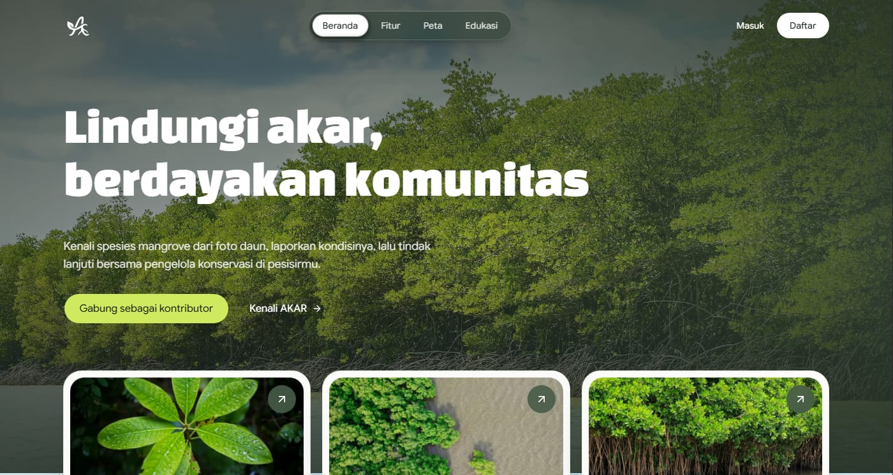
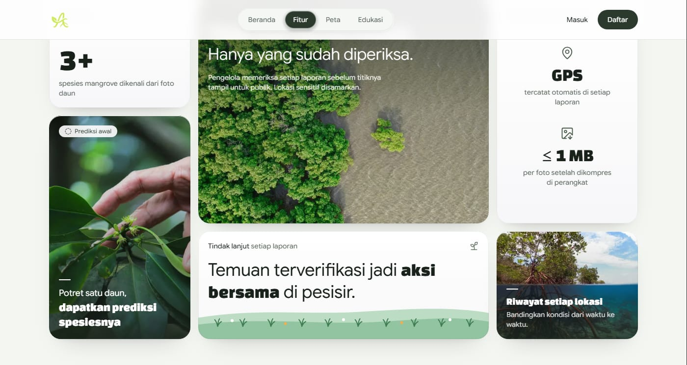
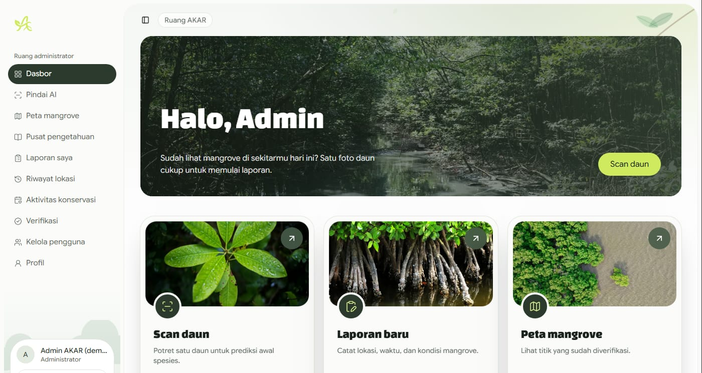
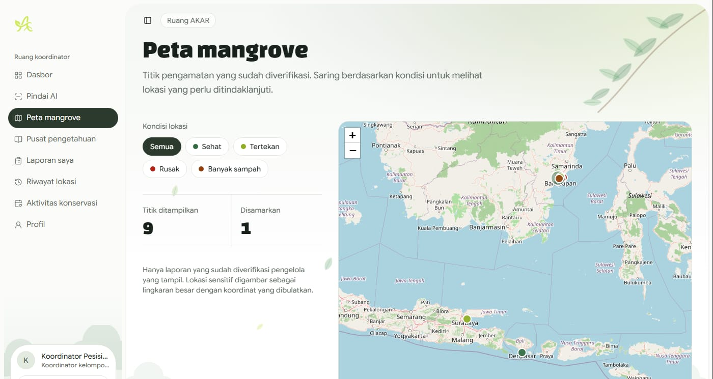
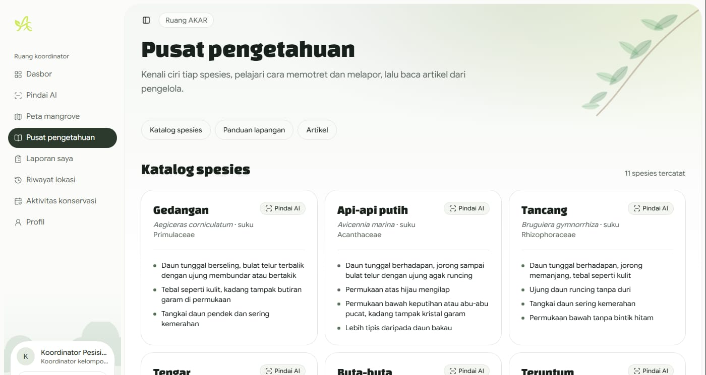
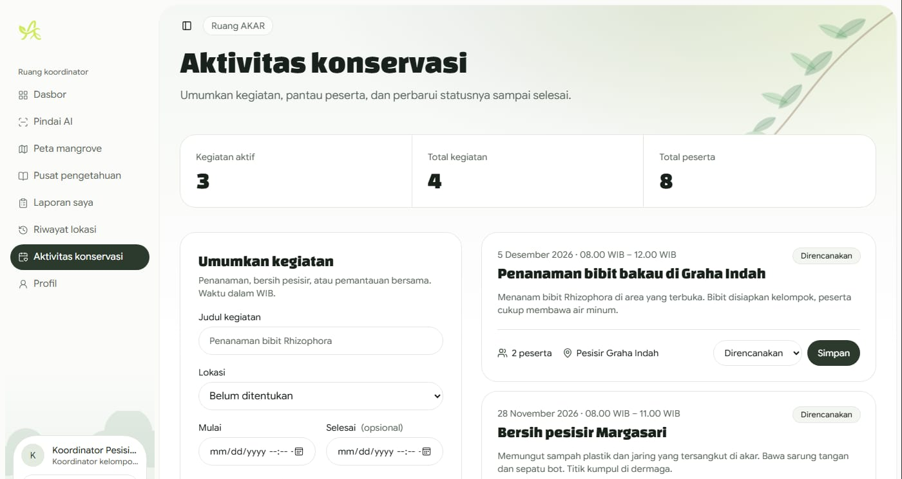
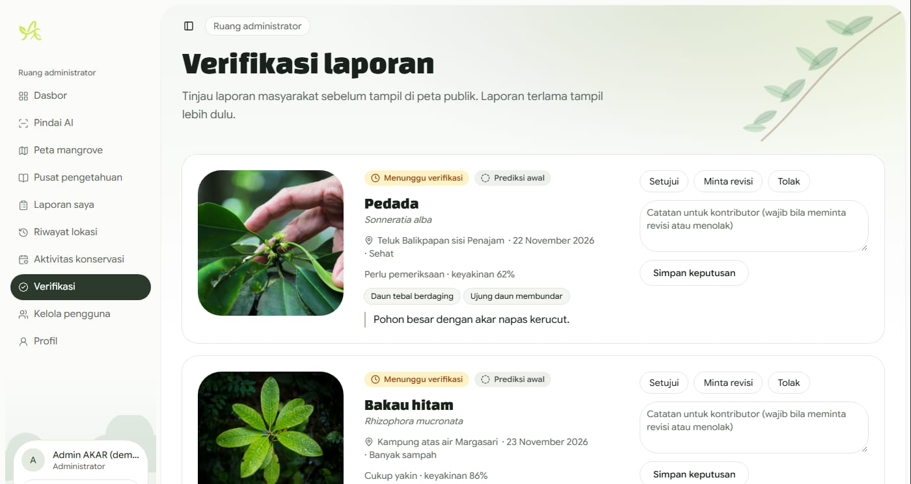

<div align="center">


# AKAR

**AI-Assisted Community-Based Mangrove Monitoring Platform**

_Lindungi akar, berdayakan komunitas._

Platform pemantauan mangrove berbasis komunitas: masyarakat memotret daun, AI memberi prediksi awal
spesies, administrator memverifikasi laporan, dan koordinator mengubah temuan menjadi aksi
konservasi.

[Fitur](#fitur) · [Tangkapan layar](#tangkapan-layar) · [Arsitektur](#arsitektur) ·
[Memulai](#memulai) · [Deployment](#deployment-ke-vercel) · [Dokumentasi](#dokumentasi-lanjutan)

</div>



---

## Daftar isi

- [Latar belakang](#latar-belakang)
- [Fitur](#fitur)
- [Pindai AI: cara kerja identifikasi](#pindai-ai-cara-kerja-identifikasi)
- [Tangkapan layar](#tangkapan-layar)
- [Tech stack](#tech-stack)
- [Arsitektur](#arsitektur)
- [Struktur repositori](#struktur-repositori)
- [Memulai](#memulai)
- [Variabel lingkungan](#variabel-lingkungan)
- [Skrip](#skrip)
- [Pengujian dan kualitas kode](#pengujian-dan-kualitas-kode)
- [Deployment ke Vercel](#deployment-ke-vercel)
- [Keamanan dan privasi](#keamanan-dan-privasi)
- [Dokumentasi lanjutan](#dokumentasi-lanjutan)
- [Kredit](#kredit)

## Latar belakang

Mangrove menahan abrasi, meredam gelombang, menyimpan karbon, dan menjadi rumah bagi ikan serta
kepiting. Data kondisinya di lapangan sering terlambat atau tidak tercatat, padahal masyarakat
pesisir melihatnya setiap hari. AKAR menjembatani keduanya:

1. **Kenali**: siapa pun bisa mengenali spesies mangrove cukup dari foto satu daun.
2. **Laporkan**: lokasi, waktu, kondisi, dan foto tercatat dalam satu formulir yang hemat kuota.
3. **Verifikasi**: administrator memeriksa setiap laporan sebelum tampil di peta publik.
4. **Bertindak**: koordinator kelompok konservasi menyusun penanaman atau bersih pesisir dari
   temuan yang terverifikasi.

Hasil AI selalu diberi label **Prediksi awal**. Data baru dianggap benar setelah diverifikasi
manusia.

## Fitur

### Ruang per peran

| Menu                 | Komunitas  | Koordinator | Administrator |
| -------------------- | :--------: | :---------: | :-----------: |
| Dasbor               |     ✓      |      ✓      |       ✓       |
| Pindai AI            |     ✓      |      ✓      |       ✓       |
| Peta mangrove        |     ✓      |      ✓      |       ✓       |
| Pusat pengetahuan    |     ✓      |      ✓      |       ✓       |
| Laporan saya         |     ✓      |      ✓      |       ✓       |
| Riwayat lokasi       |     ✓      |      ✓      |       ✓       |
| Aktivitas konservasi | ikut serta |   kelola    |    kelola     |
| Verifikasi           |            |             |       ✓       |
| Kelola pengguna      |            |             |       ✓       |
| Profil               |     ✓      |      ✓      |       ✓       |

### Sorotan

- **Pindai AI**: identifikasi spesies dari foto daun, lengkap dengan penjelasan yang mudah
  dipahami: ciri yang terlihat di foto, ciri khas spesies, tingkat keyakinan, kesepakatan analisis,
  kualitas foto, dan kemungkinan spesies lain.
- **Laporan lapangan**: GPS otomatis, empat kategori kondisi (sehat, tertekan, rusak, banyak
  sampah), dan foto dikompres di perangkat sebelum diunggah.
- **Verifikasi**: antrean berisi foto, prediksi, ciri daun, dan lokasi, dengan keputusan
  setujui / minta revisi / tolak.
- **Peta publik**: hanya titik terverifikasi; koordinat lokasi sensitif dibulatkan.
- **Riwayat lokasi**: linimasa kondisi satu lokasi dari waktu ke waktu.
- **Aktivitas konservasi**: koordinator mengumumkan kegiatan, memantau peserta, dan memperbarui
  status; komunitas mendaftar langsung dari dasbor.
- **Pusat pengetahuan**: katalog 11 spesies beserta ciri pembeda daun, panduan lapangan, dan
  artikel.
- **Kelola pengguna**: ringkasan per peran, pencarian, dan perubahan peran.

## Pindai AI: cara kerja identifikasi

Identifikasi berjalan di backend FastAPI dengan model visi-bahasa **`openai/gpt-4o-mini` melalui
OpenRouter**. Karena belum ada dataset daun mangrove terverifikasi untuk melatih klasifier,
akurasi dijaga dengan lima teknik:

| Teknik                                  | Dampak                                                                                                         |
| --------------------------------------- | -------------------------------------------------------------------------------------------------------------- |
| Katalog tertutup + JSON Schema `strict` | Model hanya boleh memilih spesies di tabel `species` atau `unknown`.                                           |
| Ciri dulu, keputusan kemudian           | Model wajib mencatat ciri daun yang terlihat sebelum memilih kandidat.                                         |
| Ciri pembeda per spesies                | Prompt memuat kunci identifikasi, mis. mukro pada _Rhizophora_ dan permukaan bawah keputihan pada _Avicennia_. |
| Ensemble + augmentasi                   | Tiga analisis paralel atas foto utuh dan potongan tengah; keyakinan dirata-rata.                               |
| Gerbang kualitas                        | "Cukup yakin" hanya bila keyakinan ≥ 80%, foto tidak buram, dan ≥ 60% analisis sepakat.                        |

Penjelasan lengkap, cara evaluasi, dan rencana model terlatih ada di [ml/README.md](ml/README.md).

## Tangkapan layar

| Fitur di beranda                              | Dasbor                                           |
| --------------------------------------------- | ------------------------------------------------ |
|        |         |
| **Peta mangrove**                             | **Pusat pengetahuan**                            |
|     |  |
| **Aktivitas konservasi (koordinator)**        | **Verifikasi (administrator)**                   |
|  |  |

## Tech stack

| Lapisan     | Teknologi                                                                                         |
| ----------- | ------------------------------------------------------------------------------------------------- |
| Web         | Next.js 16 (App Router, Cache Components, Partial Prefetching), React 19, TypeScript              |
| UI          | Tailwind CSS v4, shadcn/ui (Base UI), komponen animasi React Bits, ilustrasi SVG 2D, Leaflet      |
| Backend     | Python 3.12+, FastAPI, Pydantic v2, httpx, Pillow                                                 |
| AI          | OpenRouter → `openai/gpt-4o-mini` (visi + structured output)                                      |
| Data & Auth | Supabase: Postgres + Row Level Security, Storage, Auth (JWT asimetris + Custom Access Token Hook) |
| Kualitas    | ESLint, Prettier, TypeScript strict, Vitest, pytest, ruff                                         |

## Arsitektur

```
                     ┌──────────────────────────────────┐
  Browser ─────────▶ │ Next.js                          │
                     │ Server Components + Server Actions│
                     └───────┬──────────────────┬───────┘
          sesi cookie + RLS  │                  │ Authorization: Bearer <JWT pengguna>
                             │                  ▼
                             │       ┌───────────────────────┐       ┌──────────────┐
                             │       │ FastAPI /v1/*         │ ────▶ │ OpenRouter   │
                             │       │ verifikasi JWT (JWKS) │       │ gpt-4o-mini  │
                             │       └───────────┬───────────┘       └──────────────┘
                             ▼                   ▼
                     ┌───────────────────────────────────────────┐
                     │ Supabase: Auth · Postgres (RLS) · Storage │
                     └───────────────────────────────────────────┘
```

- **Next.js** menangani UI dan semua CRUD milik pengguna langsung ke Supabase dengan sesi
  pengguna, sehingga RLS selalu berlaku.
- **FastAPI** menangani pekerjaan yang butuh kunci rahasia: identifikasi lewat OpenRouter,
  penyimpanan foto scan, pencatatan prediksi, dan perubahan peran pengguna.
- **Supabase** menjadi sumber kebenaran; aturan akses ditegakkan di basis data.

Kode web disusun sebagai _feature-based modular monolith_: setiap fitur di `src/features/<nama>/`
memiliki `components/`, `queries.ts`, `actions.ts`, `schemas.ts`, `types.ts`, dan `index.ts`.
Aturan lengkap ada di [AGENTS.md](AGENTS.md).

## Struktur repositori

```
.
├── src/
│   ├── app/                 route: (public) (auth) (app) (admin), auth/confirm, api/health
│   ├── features/            activities · auth · dashboard · groups · knowledge · locations
│   │                        map · observations · scanner · users · verification
│   ├── components/          ui · motion · illustrations · shared · landing · layout
│   ├── lib/                 supabase · auth · api/backend · env · format
│   ├── config/              site · permissions · constants · images
│   └── types/database.ts
├── backend/                 FastAPI (app/, tests/, Dockerfile, README)
├── supabase/                migrations/, seed.sql, config.toml
├── scripts/seed-demo.mjs    data demo opsional
├── ml/                      metode identifikasi dan rencana model
├── docs/                    sistem desain, peta aset, kredit, tangkapan layar
└── public/                  ikon dan foto web (public/img/web)
```

## Memulai

### Prasyarat

- Node.js 20.9+ dan npm
- Python 3.12+ (diuji dengan 3.13); [uv](https://docs.astral.sh/uv/) opsional
- Akun [Supabase](https://supabase.com) dan [OpenRouter](https://openrouter.ai)

### 1. Clone dan pasang dependensi

```bash
git clone <url-repositori> akar-app
cd akar-app
npm install
```

### 2. Siapkan Supabase

```bash
npx supabase login
npx supabase link --project-ref <project-ref>
npx supabase db push --remote --include-seed
```

Perintah ini membuat skema, RLS, bucket foto, dan Custom Access Token Hook, lalu mengisi 11 spesies
dan 6 artikel. Bila seed tidak berjalan, tempel isi `supabase/seed.sql` di SQL Editor.

Lalu di dashboard Supabase:

1. **Authentication → Hooks → Customize Access Token**: pilih `public.custom_access_token_hook`.
2. **Authentication → URL Configuration**: isi Site URL dan Redirect URLs
   (`http://localhost:3000/**`).
3. **Email template "Confirm signup"**: tautan
   `{{ .SiteURL }}/auth/confirm?token_hash={{ .TokenHash }}&type=email`.

Rincian lengkap: [backend/README.md §7](backend/README.md#7-menyiapkan-supabase).

### 3. Jalankan backend

```bash
cd backend
cp .env.example .env          # isi SUPABASE_* dan OPENROUTER_API_KEY
python -m venv .venv
.venv/Scripts/activate        # Windows; macOS/Linux: source .venv/bin/activate
pip install -r requirements-dev.txt
uvicorn app.main:app --reload --port 8000
```

Cek <http://localhost:8000/health>: nilai `model_loaded` harus `true`.

### 4. Jalankan web

```bash
cp .env.example .env.local    # isi variabel Supabase dan BACKEND_API_URL
npm run dev                   # http://localhost:3000
```

Tanpa variabel Supabase, situs berjalan dalam **mode pratinjau**: semua halaman bisa dibuka dan
datanya kosong.

### 5. Data demo (opsional)

```bash
npm run seed:demo             # akun demo, kelompok, lokasi, laporan berfoto, aktivitas
npm run seed:demo:reset       # hapus semua data demo
```

Akun demo memakai kata sandi `AkarDemo#2026` (bisa diganti lewat `DEMO_PASSWORD`):
`demo-admin@example.com`, `demo-koordinator@example.com`, `demo-relawan@example.com`, dan
`demo-relawan2@example.com`. Jangan jalankan di project produksi.

Halaman login menampilkan panel **akun demo** (sekali klik langsung masuk) selama
`NEXT_PUBLIC_DEMO_LOGIN` bukan `off`.

Untuk admin sungguhan pertama, daftar lewat `/register` lalu jalankan SQL di
[backend/README.md §7.4](backend/README.md#74-membuat-admin-pertama).

## Variabel lingkungan

### Web (`.env.local`)

| Variabel                               | Wajib      | Keterangan                                        |
| -------------------------------------- | ---------- | ------------------------------------------------- |
| `NEXT_PUBLIC_SUPABASE_URL`             | untuk data | URL project Supabase                              |
| `NEXT_PUBLIC_SUPABASE_PUBLISHABLE_KEY` | untuk data | Publishable key Supabase                          |
| `SUPABASE_SECRET_KEY`                  | opsional   | Hanya di server                                   |
| `NEXT_PUBLIC_SITE_URL`                 | disarankan | URL situs untuk metadata dan tautan email         |
| `BACKEND_API_URL`                      | untuk scan | URL backend FastAPI, mis. `http://localhost:8000` |
| `NEXT_PUBLIC_DEMO_LOGIN`               | tidak      | Isi `off` untuk menyembunyikan panel akun demo    |

### Backend (`backend/.env`)

| Variabel                                   | Wajib | Keterangan                                        |
| ------------------------------------------ | ----- | ------------------------------------------------- |
| `SUPABASE_URL`                             | ya    | URL project Supabase                              |
| `SUPABASE_PUBLISHABLE_KEY`                 | ya    | Klien per pengguna (RLS berlaku)                  |
| `SUPABASE_SECRET_KEY`                      | ya    | Klien admin; rahasia                              |
| `OPENROUTER_API_KEY`                       | ya    | Rahasia; tanpa ini scan mengembalikan 503         |
| `OPENROUTER_MODEL`                         | tidak | Default `openai/gpt-4o-mini`                      |
| `IDENTIFY_SAMPLES`                         | tidak | Jumlah analisis paralel per scan (1–5, default 3) |
| `APP_URL`                                  | tidak | URL web, dikirim sebagai atribusi ke OpenRouter   |
| `CONFIDENT_THRESHOLD` / `REVIEW_THRESHOLD` | tidak | Ambang status prediksi (default 0,80 / 0,50)      |

Daftar lengkap: [backend/README.md §6](backend/README.md#6-variabel-lingkungan).
**Kunci rahasia tidak pernah dikirim ke browser.**

## Skrip

| Perintah                  | Fungsi                                   |
| ------------------------- | ---------------------------------------- |
| `npm run dev`             | Server pengembangan                      |
| `npm run build` / `start` | Build dan jalankan versi produksi        |
| `npm run lint`            | ESLint                                   |
| `npm run typecheck`       | `next typegen` + `tsc --noEmit`          |
| `npm test`                | Vitest                                   |
| `npm run format`          | Prettier (+ urutan kelas Tailwind)       |
| `npm run seed:demo`       | Isi data demo (`:reset` untuk menghapus) |

## Pengujian dan kualitas kode

```bash
npm run lint && npm run typecheck && npm test && npm run build

cd backend
pytest -q
ruff check . && ruff format --check .
```

Tes backend memakai identifier dan repository tiruan, sehingga tidak memanggil OpenRouter atau
Supabase. Cakupannya meliputi autentikasi JWT, validasi gambar, penggabungan hasil ensemble,
gerbang kualitas, dan kontrak respons.

## Deployment ke Vercel

AKAR terdiri dari dua aplikasi dalam satu repositori. Keduanya di-deploy ke Vercel sebagai **dua
project terpisah** dari repositori yang sama.

### Project 1: web (Next.js)

1. **Add New → Project**, impor repositori ini. Root Directory: `./` (default). Framework: Next.js.
2. Environment variables: `NEXT_PUBLIC_SUPABASE_URL`, `NEXT_PUBLIC_SUPABASE_PUBLISHABLE_KEY`,
   `NEXT_PUBLIC_SITE_URL` (URL produksi web), dan `BACKEND_API_URL` (URL project backend).
3. Deploy.

### Project 2: backend (FastAPI)

1. **Add New → Project**, impor repositori yang sama dengan **Root Directory: `backend`**. Vercel
   mendeteksi FastAPI dari `app/main.py`; entrypoint juga ditetapkan di `pyproject.toml`
   (`[tool.vercel] entrypoint = "app.main:app"`), dan dependensi dipasang dari `pyproject.toml`.
2. Environment variables: semua isi `backend/.env` (`SUPABASE_*`, `OPENROUTER_API_KEY`, dll.),
   dengan `APP_URL` berisi URL web produksi.
3. Deploy, lalu buka `https://<backend>.vercel.app/health`.
4. Kembali ke project web, isi `BACKEND_API_URL` dengan URL backend, lalu redeploy.

### Setelah deploy

- Supabase → Authentication → URL Configuration: tambahkan URL produksi web ke Site URL dan
  Redirect URLs (`https://<web>.vercel.app/**`).
- Batas Vercel yang relevan: body request maksimal 4,5 MB (foto sudah dikompres ≤ 1 MB dan Server
  Action dibatasi 2 MB), serta durasi fungsi default 300 detik (identifikasi selesai dalam ±5–15
  detik).
- Pasang batas kredit di dashboard OpenRouter, dan batasi laju scan per pengguna bila trafik
  meningkat.

Alternatif untuk backend: `backend/Dockerfile` siap dipakai di Railway, Render, Fly.io, atau Google
Cloud Run.

## Keamanan dan privasi

- JWT Supabase diverifikasi lewat JWKS (`exp`, `aud`, `iss`) di setiap request backend.
- RLS di Postgres menjadi penjaga terakhir; peran disisipkan ke JWT lewat Custom Access Token Hook.
- Foto disimpan di bucket privat, satu folder per pengguna. Peta publik hanya membaca view
  `public_map_points`, dengan koordinat lokasi sensitif dibulatkan.
- Foto daun dikirim ke OpenRouter untuk identifikasi tanpa nama, email, atau lokasi pengguna.
- Kunci rahasia (`SUPABASE_SECRET_KEY`, `OPENROUTER_API_KEY`) hanya ada di server.

## Dokumentasi lanjutan

| Dokumen                                        | Isi                                                      |
| ---------------------------------------------- | -------------------------------------------------------- |
| [backend/README.md](backend/README.md)         | Setup Supabase, API, autentikasi, model data, deployment |
| [supabase/README.md](supabase/README.md)       | Migrasi dan seed                                         |
| [ml/README.md](ml/README.md)                   | Metode identifikasi, evaluasi, rencana model terlatih    |
| [docs/design-system.md](docs/design-system.md) | Tipografi, warna, gerak, ilustrasi                       |
| [docs/asset-map.md](docs/asset-map.md)         | Pemetaan foto ke komponen                                |
| [AGENTS.md](AGENTS.md)                         | Aturan arsitektur dan gaya kode                          |

## Kredit

- Foto: Unsplash dan sumber lain, tercatat di [docs/assets-credits.md](docs/assets-credits.md).
- Peta: © kontributor [OpenStreetMap](https://www.openstreetmap.org/copyright).
- Komponen animasi: [React Bits](https://reactbits.dev).
- Font: Changa One dan Google Sans Flex melalui Google Fonts.
